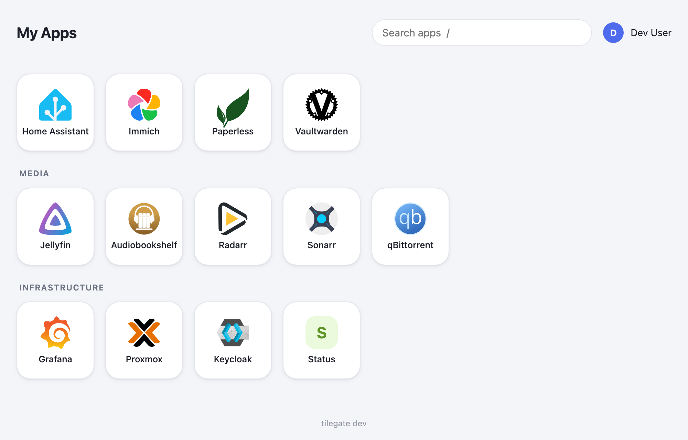
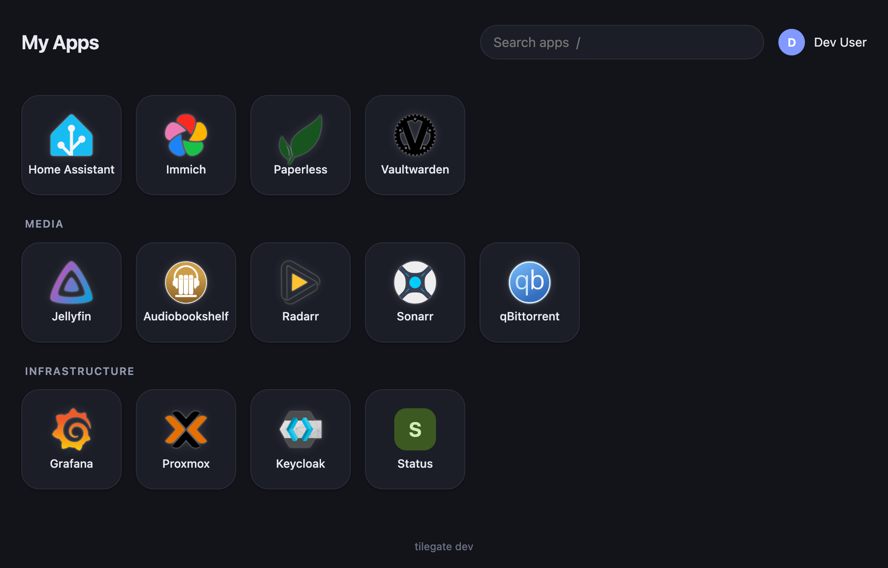
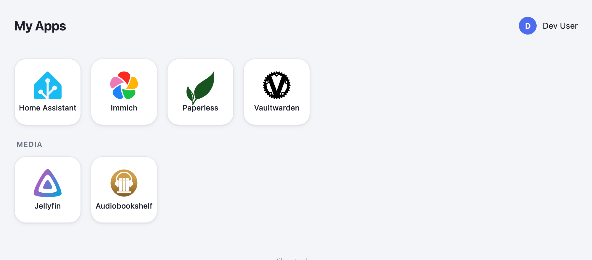
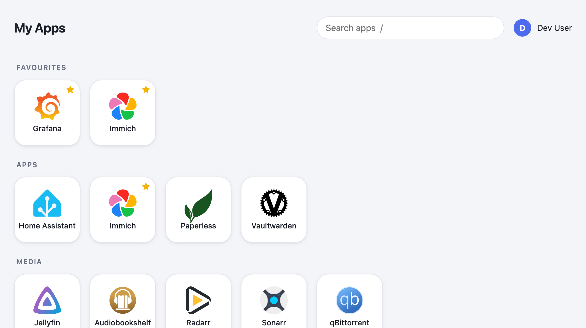
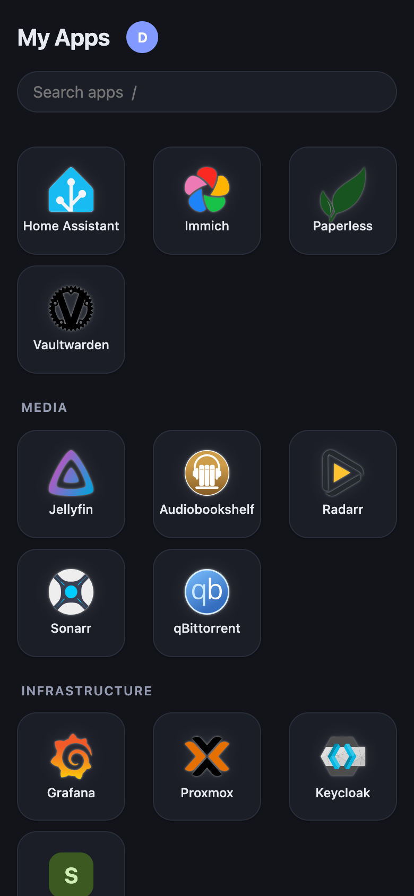

<p align="center">
  
</p>

<h1 align="center">tilegate</h1>

<p align="center">
  A self-hosted "My Apps" page that shows each signed-in user only the apps they're allowed to use.
</p>

<p align="center">
  <a href="https://github.com/chillincool/tilegate/actions/workflows/ci.yml"></a>
  <a href="https://github.com/chillincool/tilegate/releases"></a>
  <a href="LICENSE"></a>
</p>



List your apps in a YAML file and say which roles or groups may see each one. tilegate reads the user's roles from their OIDC token and renders only the matching tiles. The filtering happens on the server, so apps a user can't open never reach their browser.

## Contents

- [Features](#features)
- [Quick start](#quick-start)
- [Choosing an auth mode](#choosing-an-auth-mode)
- [Deploying](#deploying)
- [Things to know](#things-to-know)
- [Documentation](#documentation)
- [Development](#development)

## Features

- **Per-user tiles.** Roles come from any claim (`groups`, `realm_access.roles`, `resource_access.<client>.roles`, …), and an app can check its own claim.
- **Two ways to sign in.** tilegate can run its own OIDC login, or verify the token an auth proxy forwards (Envoy Gateway, oauth2-proxy, Traefik forward-auth).
- **Favourites.** Users star the apps they use most, and those stay at the top of the page on every device. Needs a database: SQLite, PostgreSQL, or a CloudNativePG cluster the Helm chart creates.
- **Light and dark modes.** Each user picks Auto, Light or Dark. Admins can theme the tile size, colours, backgrounds, logo, favicon, and add custom CSS.
- **Skip apps' login pages.** A per-app `loginURL` sends the tile straight to the app's SSO entry point.
- **Small and stateless.** One static Go binary in a distroless, non-root image for amd64 and arm64. Sessions are encrypted cookies, and the apps file reloads when it changes.

| Dark mode | Fewer roles | Favourites | Mobile |
|---|---|---|---|
|  |  |  |  |

## Quick start

**See the filtering in 30 seconds** (no login; every visitor gets the groups you list):

```sh
curl -O https://raw.githubusercontent.com/chillincool/tilegate/main/examples/apps.yaml
docker run --rm -p 8080:8080 -v "$PWD/apps.yaml:/config/apps.yaml:ro" \
  -e TILEGATE_AUTH_MODE=dev -e TILEGATE_DEV_GROUPS=family,media \
  ghcr.io/chillincool/tilegate:latest
```

**Full demo with a real login.** [`examples/docker-compose`](examples/docker-compose) runs Keycloak with three test users, plus tilegate with favourites turned on:

```sh
git clone https://github.com/chillincool/tilegate && cd tilegate/examples/docker-compose
docker compose up --build
```

Open <http://localhost:8080> and sign in as `alice`, `bob` or `carol`; each password is the same as the username. Each user sees different tiles.

A minimal apps file:

```yaml
title: My Apps
apps:
  - name: Grafana
    url: https://grafana.example.com
    icon: di:grafana       # from the dashboard-icons project
    roles: [admins]        # users with ANY of these roles see it
  - name: Wiki
    url: https://wiki.example.com   # no roles: every signed-in user sees it
```

Every option is in [docs/apps-file.md](docs/apps-file.md).

## Choosing an auth mode

| Mode | Use it when | How it works |
|---|---|---|
| **`oidc`** (default) | You want tilegate to handle sign-in itself. Simplest, and works anywhere. | tilegate is an OIDC client of your identity provider and keeps the session in an encrypted cookie. |
| **`proxy-jwt`** | Your auth proxy already handles sign-in for your apps, and you want tilegate to fit in. | The proxy signs the user in and forwards their access token. tilegate checks the token's signature before trusting it. |
| **`proxy-header`** | Your proxy can only pass plain headers like `X-Forwarded-Groups`. | tilegate trusts those headers, but only from proxy addresses you list. |

**Why have both built-in login and proxy modes?** If tilegate is your only app, or your apps each handle their own login, the built-in mode needs nothing else. Many self-hosters instead run every app behind one auth proxy. That keeps access rules in one place, means unauthenticated requests never reach the app at all, and gives one sign-out for everything. Some won't run an app that handles its own auth. The proxy modes let tilegate fit that setup, and they're tested as thoroughly as the built-in login.

Identity provider setup and every setting: [docs/configuration.md](docs/configuration.md#auth-modes).

## Deploying

**Docker:** see the [compose example](examples/docker-compose/compose.yaml). All settings are environment variables.

**Kubernetes:** the Helm chart is published to GHCR:

```sh
helm install tilegate oci://ghcr.io/chillincool/charts/tilegate -f values.yaml
```

```yaml
# values.yaml: built-in login, favourites in SQLite, Gateway API route
auth:
  oidc:
    issuer: https://login.example.com/realms/home
    redirectURL: https://apps.example.com/auth/callback
  existingSecret: tilegate-oidc    # keys: client-secret, session-secret
persistence:
  enabled: true
route:
  enabled: true
  hostnames: [apps.example.com]
  parentRefs: [{ name: envoy-external, namespace: network }]
config:
  apps:
    - { name: Grafana, url: "https://grafana.example.com", icon: "di:grafana", roles: [admins] }
```

All chart options: [`values.yaml`](charts/tilegate/values.yaml). Flux, Envoy Gateway and Keycloak walkthrough: [docs/deploy/envoy-gateway-flux.md](docs/deploy/envoy-gateway-flux.md).

## Things to know

- **tilegate controls which links people see, not who can open the apps.** Hiding a tile doesn't block the app. Each app still needs its own login, or a proxy in front of it.
- **Role changes take effect at the next sign-in** in `oidc` mode, because roles are read when the user signs in. Sessions last 8 hours by default (`TILEGATE_SESSION_TTL`). In the proxy modes, roles are read from every request, so changes show up as soon as the proxy issues a new token.
- **Favourites need a database.** Without one there are no stars; there's deliberately no browser-only fallback. SQLite is limited to one replica; use PostgreSQL to run more.
- **Renaming an app loses its favourites** unless you give it a fixed `id`. Favourites are saved by `id`, which defaults to a slug of the name.
- **`loginURL` can't help apps whose SSO only starts from a form submission.** A link can only send a GET request, so for those apps it gets you one page closer but not all the way.
- **`proxy-header` mode trusts unsigned headers.** It refuses to start without `TILEGATE_TRUSTED_PROXIES`, ignores headers from any other address, and doesn't support per-app `claim:` settings. Prefer `proxy-jwt` if your proxy can forward a token.
- **`di:` icons load from the jsDelivr CDN,** so the CDN sees which icon names a browser requests. To avoid that, serve icons from your own folder with `TILEGATE_ICONS_DIR`.
- **Many groups make a large cookie.** In `oidc` mode the user's roles live in the session cookie, and browsers reject cookies over about 4 KB. If someone belongs to hundreds of groups, narrow `TILEGATE_ROLES_CLAIM`; tilegate logs a warning when this happens.
- **Tiles grow to fit the longest single word** in any app name, so names never break mid-word. All tiles grow together and stay the same size.
- **The theme choice is per browser** unless a database is configured, in which case it follows the user to other devices.

## Documentation

| Guide | Covers |
|---|---|
| [Apps file](docs/apps-file.md) | Apps, icons, `loginURL`, categories, theming, favourites |
| [Configuration](docs/configuration.md) | Auth modes, roles claims, databases (including CloudNativePG), every environment variable |
| [Envoy Gateway + Flux](docs/deploy/envoy-gateway-flux.md) | A complete Kubernetes example with Keycloak |
| [Security](docs/security.md) | How sessions, tokens and the container are protected |

## Development

```sh
mise install && mise run ci     # unit tests, lint, chart checks, image build
mise run e2e                    # end-to-end tests in a throwaway kind cluster
```

See [CONTRIBUTING.md](CONTRIBUTING.md). Report vulnerabilities privately: [SECURITY.md](SECURITY.md).

## License

[MIT](LICENSE)
